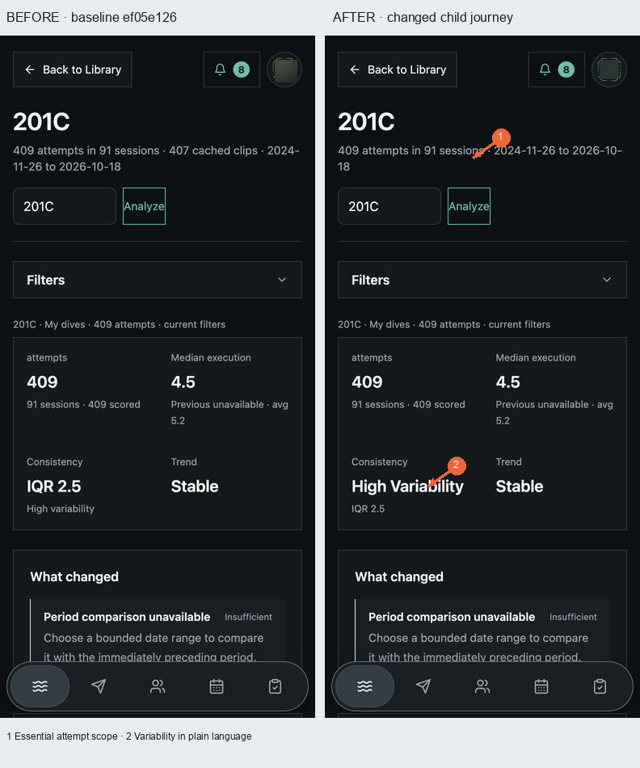
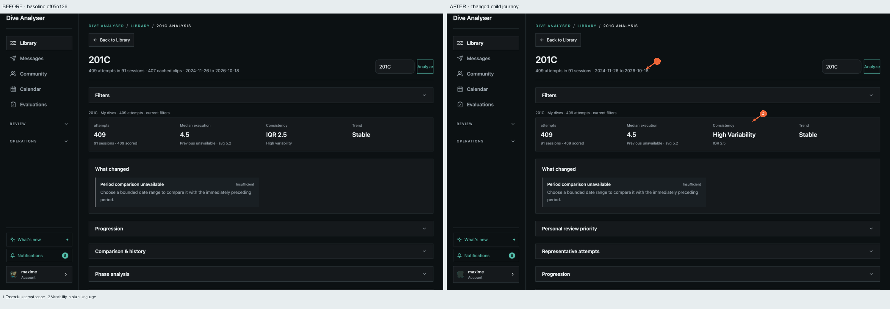
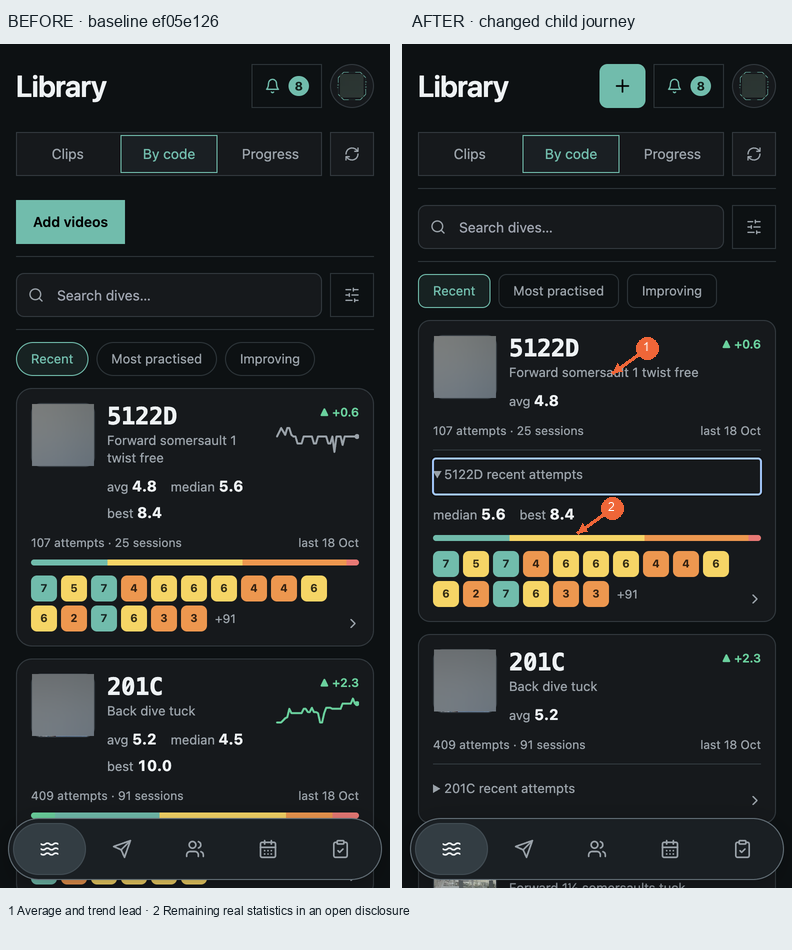
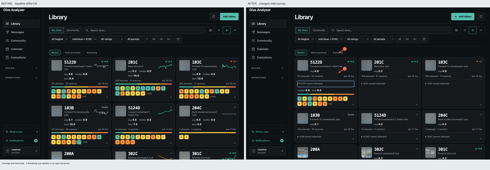
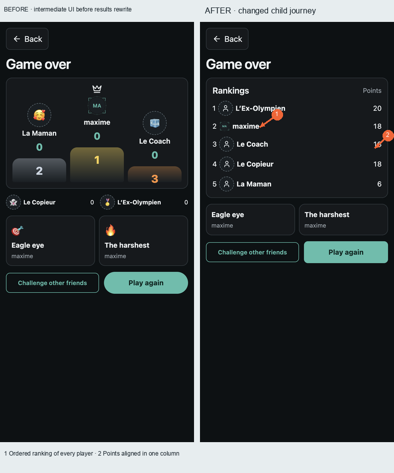
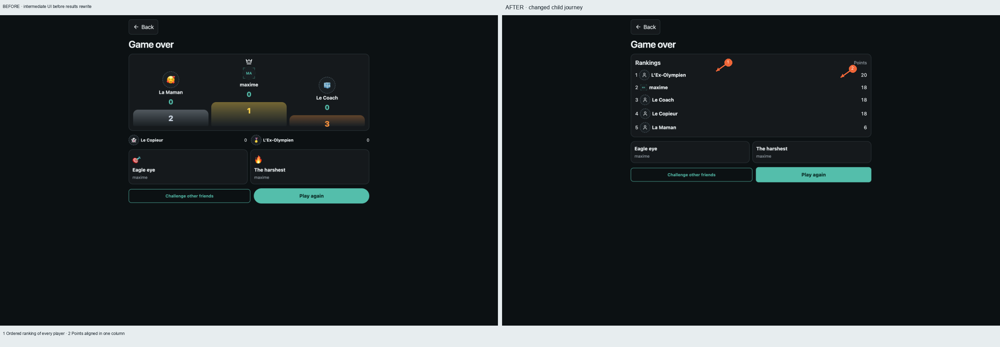

# Child comparisons

Real original screenshots retained outside Git, with hashes below. Media blurred in derived copies; controls and score values preserved. No AI image editing. Code/details compare baseline ef05e126 UI with run01 UI retained in the current candidate. Results compare an actual intermediate capture before the results rewrite against the later Classic result; same player set/mode, different game and point totals. The results BEFORE is explicitly not presented as the pristine baseline.

These comparisons are evidence of presentation changes, not independent council scores. [Run score evolution](../SCORE_EVOLUTION.md), [reported70-cell Muse matrix](../round-02/muse.json), [current candidate self matrix](../run-02/self-scorecard.json).

## analysis-details · 390×844

## analysis-details · 1440×900

## code-disclosure · 390×844

## code-disclosure · 1440×900

## room-results · 390×844

## room-results · 1440×900

