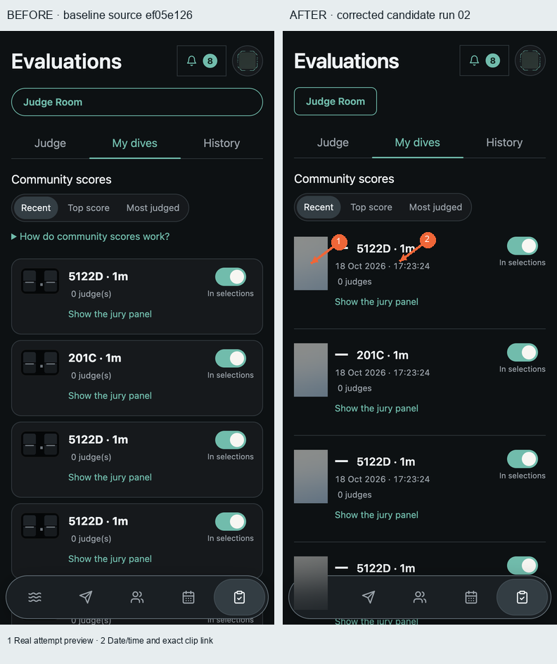
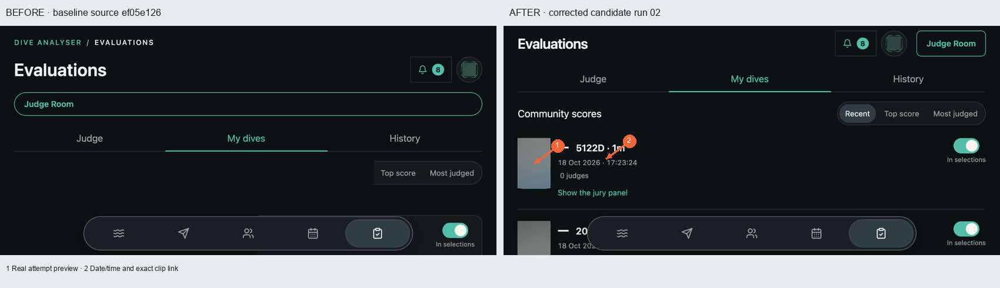
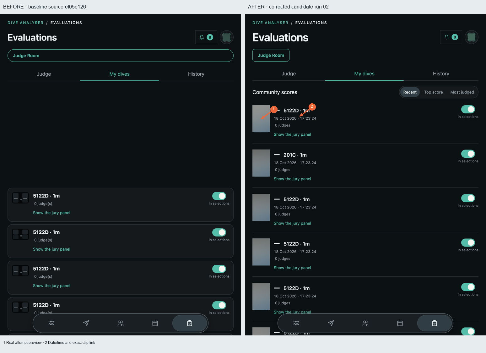
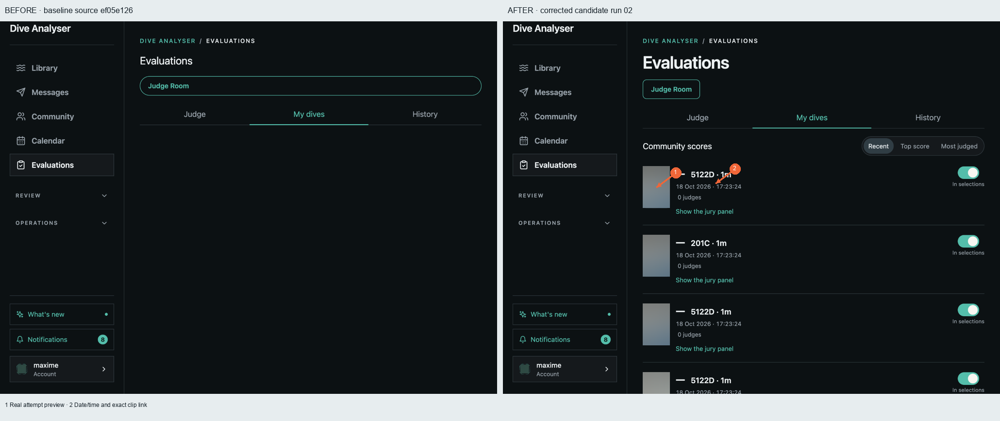
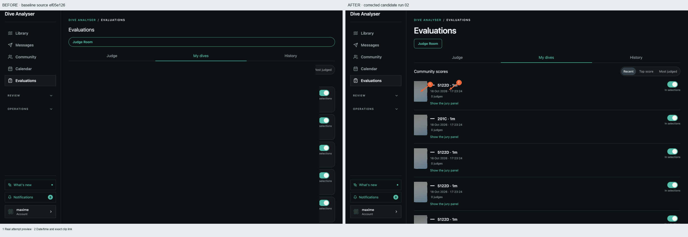
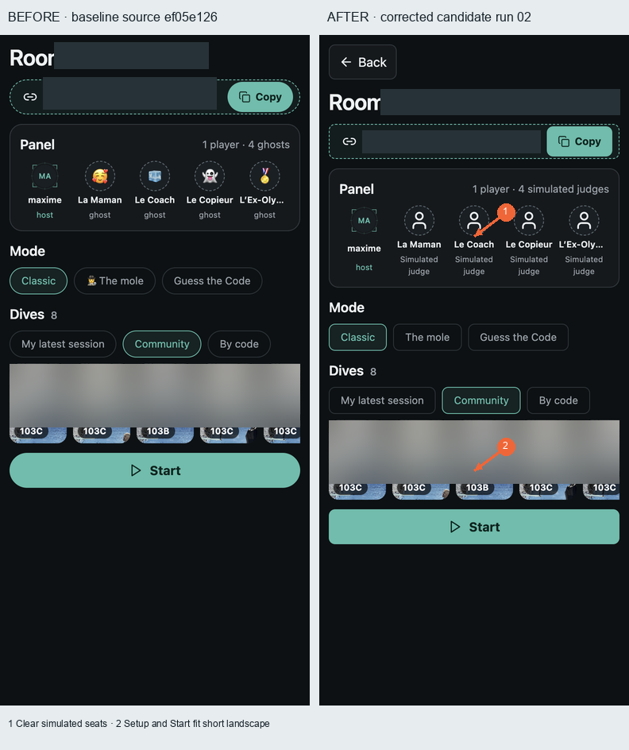
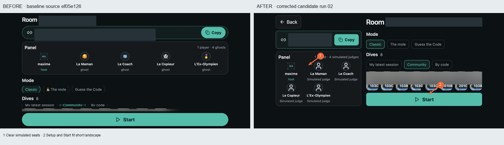
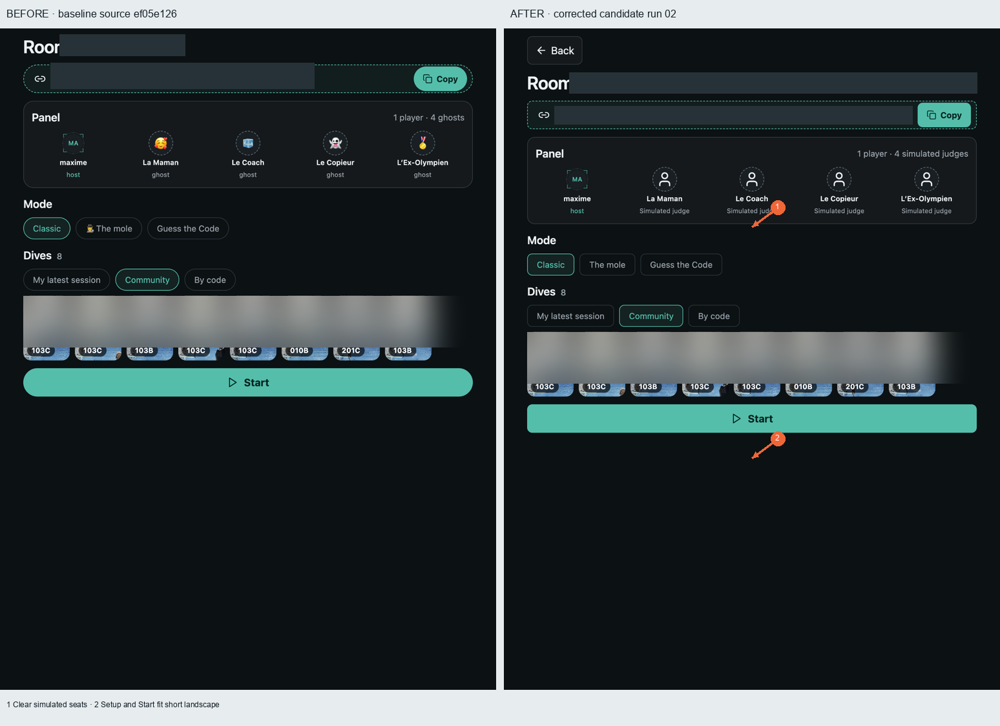
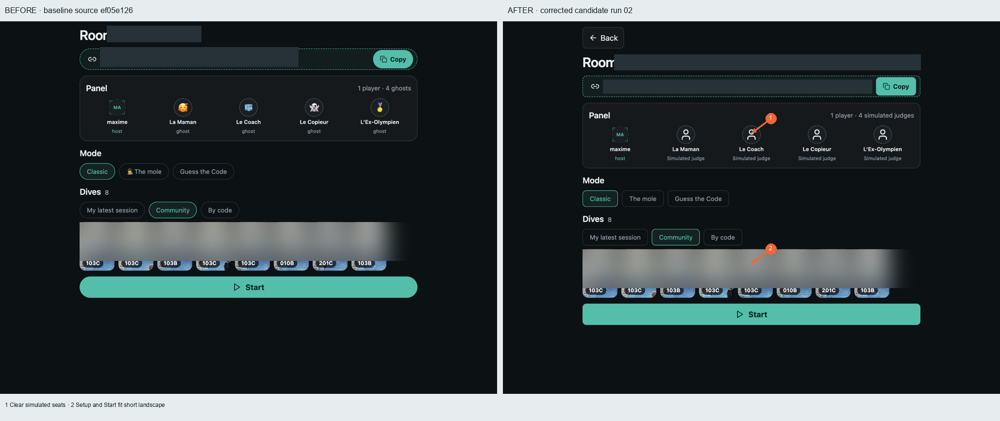
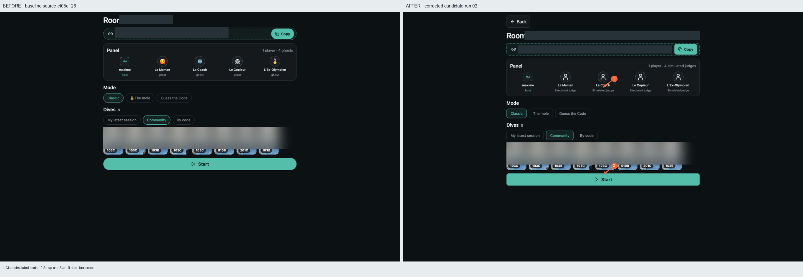

# Run 02 — corrections confirmees

Originals retained outside Git. Real populated candidate, same fixed localhost4317/default profile. Derived screenshots only: private media blur, room invitation redaction, arrows and numbered callouts. No AI editing. Matching size/content: current My dives page; Classic lobby with eight Community dives. Different temporary auditroom code is redacted.

Scores: see [self assessment](self-scorecard.json) and council records. Images do not establish a passing score.

## my-dives · 390×844

## my-dives · 844×390

## my-dives · 768×1024

## my-dives · 1024×768

## my-dives · 1440×900

## room-lobby · 390×844

## room-lobby · 844×390

## room-lobby · 768×1024

## room-lobby · 1024×768

## room-lobby · 1440×900

