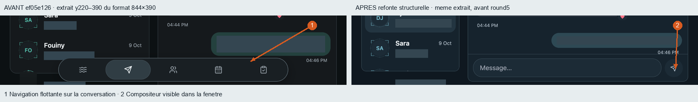

# Structural direction — actual comparisons

Uncommitted candidate, not yet reviewed. Baseline originals retained; source records linked. No AI editing. Private media and DM text sanitized on derived copies only.

![/dives?view=codes [844, 390]](images/named-navigation-844x390.png)

Messages derivative rejected: privacy masks must be clipped to scrolling message content before publication. Original captures retained privately.

## Conversation footer — recovered safe comparison

Same844×390viewport, samecrop y220–390. Clean sanitized derivatives are retained separately from arrows. [Provenance and limits](thread-footer-comparison.json). After is a structural working candidate, not the current d27eb728 or an accepted council result; exact capture HEAD was not recorded. This replaces the rejected header-masking pair without altering originals.
