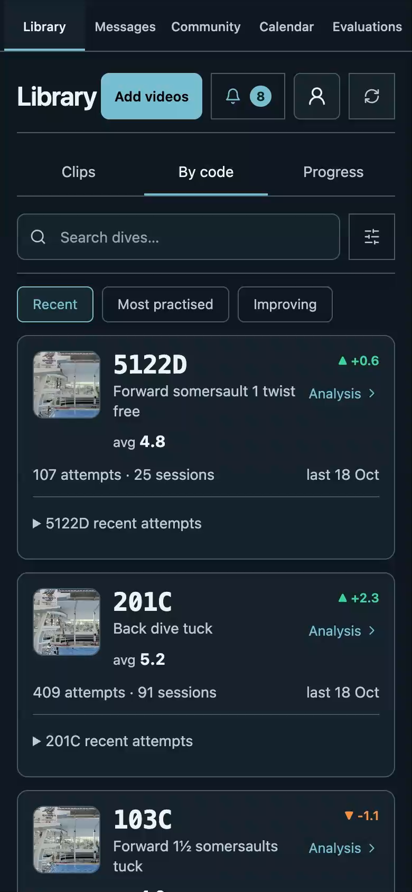
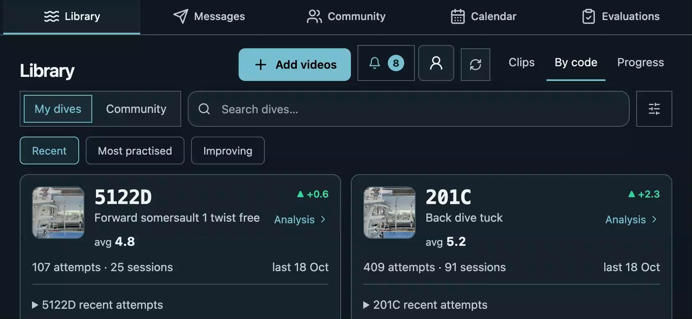
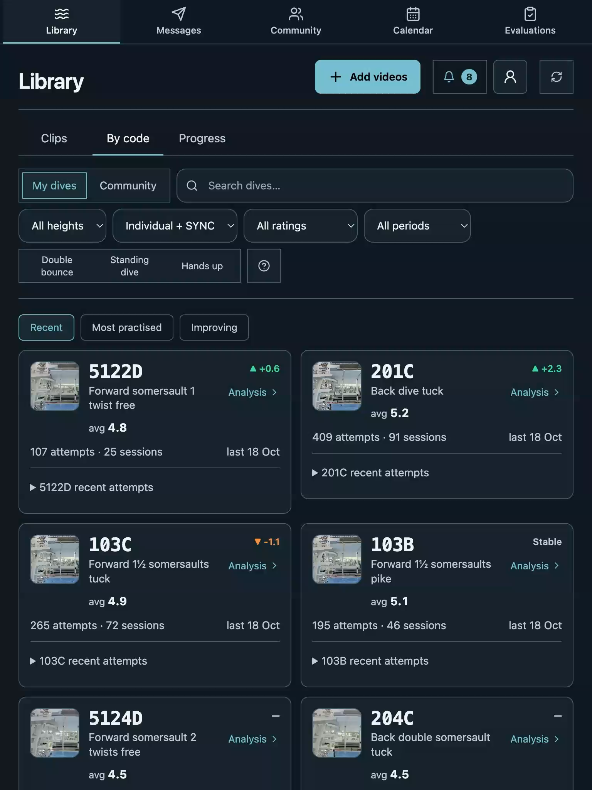
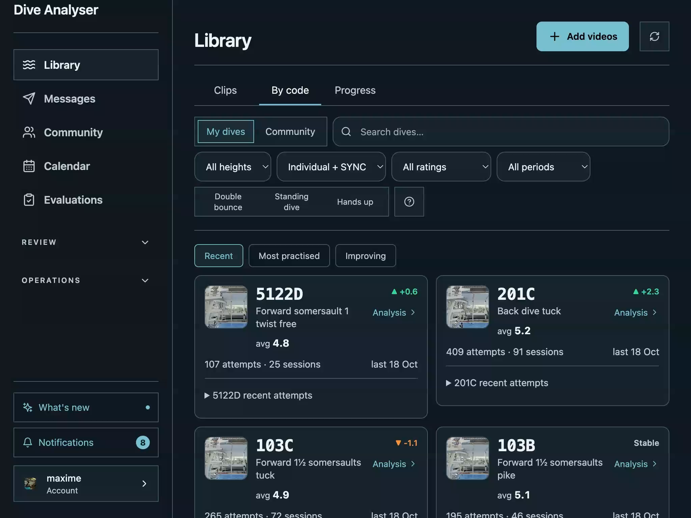
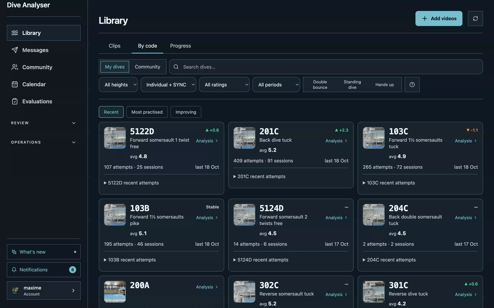

# Recovered By-code recordings

Actual frames from the interrupted run. Capture SHA could not be established; these images cannot validate the current source or change a score. The original private recordings are retained.

## 390 × 844

## 844 × 390

## 768 × 1024

## 1024 × 768

## 1440 × 900

