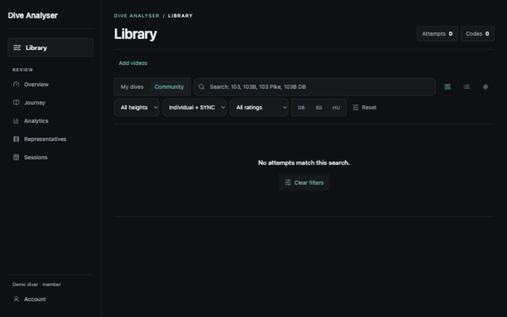
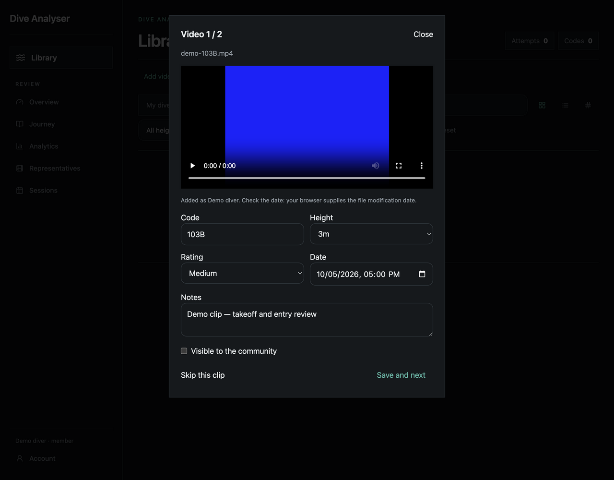
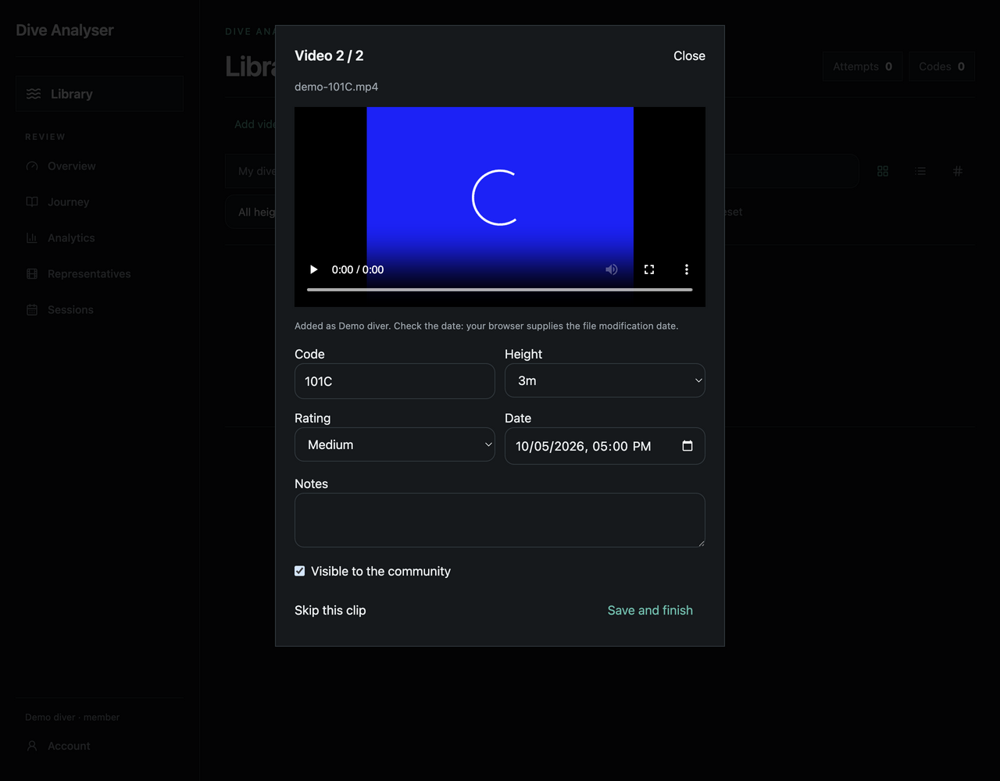
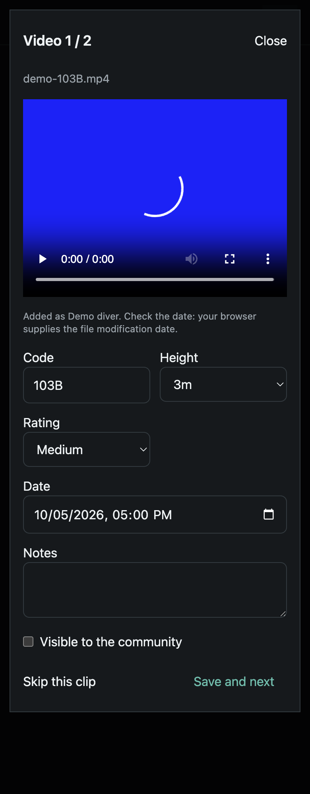
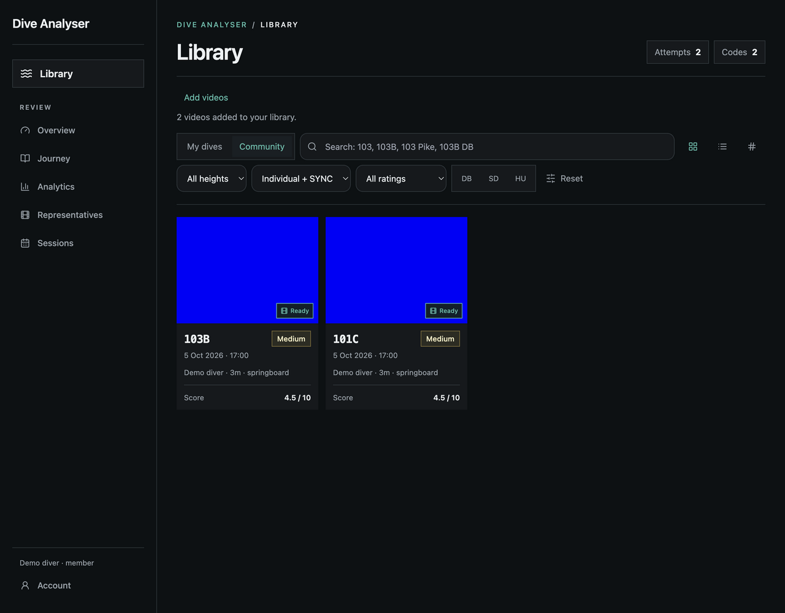

# Browser video import — review captures

These screenshots show the actual React interface in a local browser, using a
synthetic account (`Demo diver`), generated test videos, and a fixture API.
No personal media, account secrets, or production user records appear here.
The native operating-system picker is represented by its resulting multi-file
selection; browser automation supplies two File objects to the real input.

1. **Add videos** opens the native video picker with multiple selection.
   
2. **Video 1 / 2** previews the selected file and requests its code, height,
   rating, date and optional notes. Community visibility is off by default.
   
3. **Save and next** advances after a successful upload. Each clip keeps its
   own metadata and visibility. Upload failures keep the current clip for retry.
   
4. The same form fits a narrow mobile viewport; the date gets a full-width row.
   
5. Finishing refreshes the Library with the saved clips, dates and diver name.
   

Originals go to the selected B2 environment under content-addressed keys and are
roundtrip-verified before the dive and media-backbone records are committed.
Pinned H.264 previews and posters use the existing access-controlled local cache.
The screenshots demonstrate UI states; actual B2 upload and verification were
checked separately with a synthetic 1.8 KB video against the production bucket.
